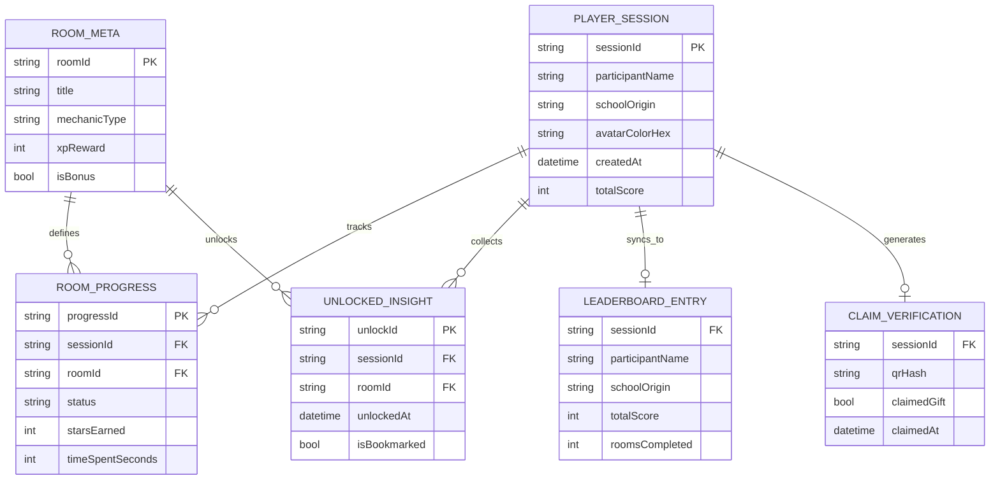

MASTER DOCUMENTATION

# Campus Escape

Aplikasi mobile escape-room gamified buat ngenalin jurusan Computer Science / Software Engineering ke siswa SMA pas Campus Open House. Dokumen ini ngerangkum semua hal — produk, arsitektur, model data, alur, layar, dan status pengerjaan — jadi satu referensi tunggal.

**Versi** 1.0 **Disusun oleh** Kevin Aprilio **Status** Living document

DAFTAR ISI

1. [Ringkasan Produk](#s1)
2. [Masalah & Solusi](#s2)
3. [Target Pengguna](#s3)
4. [Identitas Visual](#s4)
5. [Arsitektur & Tech Stack](#s5)
6. [Model Data (ERD)](#s6)
7. [Alur Aplikasi](#s7)
8. [Peta Layar](#s8)
9. [Mekanik 6 Ruang Puzzle](#s9)
10. [Functional Requirements](#s10)
11. [Status Implementasi](#s11)
12. [Roadmap](#s12)

## 01. Ringkasan Produk

Campus Escape mengganti tur kampus satu arah dengan pengalaman escape-room virtual. Siswa "masuk" ke dunia jurusan CS/SE lewat 6 ruangan interaktif (4 inti + 2 bonus), tiap ruangan punya mini-game yang ngajarin satu konsep nyata (algoritma, software engineering, UI/UX, data science, AI, keamanan siber), diselingi Insight Card berisi info karier & proyek mahasiswa asli.

Splash → Pilih Avatar → Home Hub ⇄ Peta Kampus ⇄ Leaderboard → masuk salah satu dari 6 Ruang Puzzle → Insight Card → (4 ruang inti selesai) → Sertifikat & Klaim Hadiah

## 02. Masalah & Solusi

#### Masalah

- Siswa sulit bedain CS vs SE vs Data Science vs UI/UX cuma dari penjelasan verbal
- Waktu kunjungan terbatas (\~20-30 menit per rombongan)
- Banyak siswa takut duluan sama "coding" sebelum nyoba
- Sinyal kampus nggak stabil di beberapa titik, device siswa bervariasi

#### Solusi

- Mekanik visual-interaktif, bukan baca syntax (drag, swipe, tap reflex)
- Offline-first — semua gameplay jalan tanpa internet
- Zero-friction onboarding — tanpa password, cukup nama + warna avatar
- Insentif nyata: sertifikat digital + klaim suvenir fisik via QR

## 03. Target Pengguna

#### Primary — Calon Mahasiswa

Siswa SMA kelas 11-12, visual learner, suka game interaktif. Goal: tau apakah passion-nya cocok di CS/SE. Takut coding/matematika susah.

#### Secondary — Panitia / Lab Mentor

Mahasiswa tingkat atas yang jagain booth, mandu 30-50 siswa per gelombang. Butuh tools buat mastiin kunjungan tertib & terukur (lihat §11 Admin Dashboard).

## 04. Identitas Visual

navy\
#2F3C7E

gold\
#F9E795

coral\
#F96167

success\
#2ECC71

error\
#E74C3C

locked\
#D1D5DB

### Tipografi

**Baloo 2** (bold/rounded) — judul, tombol, HUD. **Inter** — body & label. **JetBrains Mono** — potongan kode (Ruang SE & Data Science aja).

### Mascot — ByteBot

Robot bulat navy, visor mata bulat putih, 4 ekspresi (senang/mikir/bingung/excited) nyesuaiin state layar.

### Gaya Interaksi — "Chunky Tactile"

Tombol & card penting punya "shelf" shadow solid 4px di bawahnya; pas ditekan shelf-nya hilang & elemen turun 4px (efek squish). Border 2px solid, bukan shadow blur halus — kesan kartun yang bisa "dipencet beneran".

## 05. Arsitektur & Tech Stack

- **Frontend** — Flutter (iOS/Android), Flame buat scene 2D ruangan, Riverpod buat state management
- **Animasi aksen** — Rive/Lottie, dipakai selektif
- **Local storage** — Hive (offline-first, write-through tiap progress berubah)
- **Backend** — Firebase/Firestore atau AWS Lambda+DynamoDB — cuma buat data yang emang butuh agregat lintas peserta (Leaderboard, Admin Dashboard), bukan buat gameplay inti
- **Sync strategy** — deferred/background sync pas koneksi stabil, nggak blocking interaksi user

Prinsip pembagian: kalau datanya cuma soal "progress saya sendiri" → lokal di Hive. Kalau datanya "dibandingkan/digabung sama peserta lain" → wajib lewat backend, nggak bisa murni lokal.

## 06. Model Data (ERD)

**PLAYER_SESSION** jadi hub. **ROOM_PROGRESS** & **UNLOCKED_INSIGHT** murni lokal (Hive). **LEADERBOARD_ENTRY** & **CLAIM_VERIFICATION** disinkron ke backend (makanya relasinya `0|1` — satu snapshot per sesi). **ROOM_META** data statis/config, bukan per-user.

## 07. Alur Aplikasi

Landing Page → Onboarding (Avatar + Nama) → Home Hub ⇄ Campus Map ⇄ Leaderboard → \[masuk salah satu dari 6 Ruang Puzzle\] → Insight Card (unlock) → balik ke Map → (semua ruang inti selesai) → Ringkasan Akhir & Sertifikat → Galeri Koleksi Kartu Wawasan (akses kapan aja dari Home) \[Terpisah, buat panitia\] → Admin Dashboard

## 08. Peta Layar

| Kelompok | Layar |
| --- | --- |
| Onboarding & Masuk | Landing Page, Onboarding & Pemilihan Avatar |
| Hub & Navigasi | Home Hub, Campus Map / Level Hub, Leaderboard |
| 6 Ruang Puzzle | Lab Algoritma, Lab Software Engineering, Lab UI/UX, Lab Data Science, Bonus Lab AI, Bonus Bunker Keamanan Siber |
| Reward & Koleksi | Insight Card (modal unlock), Galeri Koleksi Kartu Wawasan |
| Penutup | Ringkasan Akhir, Sertifikat & Klaim Hadiah |
| Internal | Admin / Panitia Dashboard |

## 09. Mekanik 6 Ruang Puzzle

| Ruang | Tier | Mekanik | Status |
| --- | --- | --- | --- |
| Algoritma | Inti | Susun blok aksi, ByteBot jalan beneran di grid | Tervalidasi |
| Software Engineering | Inti | Drag kartu kode ke celah kosong di diagram loop | Direvisi & valid |
| UI/UX | Inti | Sandbox live: ubah ukuran/warna/jarak, metrik WCAG & fat-finger berubah real-time | Tervalidasi (terkuat) |
| Data Science | Inti | Swipe kartu data kotor, gauge akurasi model berubah live | Tervalidasi |
| Kecerdasan Buatan (AI) | Bonus | Reflex game — tap sortir gambar, meter akurasi training naik | Dispek, blm digenerate |
| Keamanan Siber | Bonus — penutup | Whack-a-mole — kunci pintu lemah sebelum scanner lewat | Dispek, blm digenerate |

Pola umum: ganti "baca opsi → pilih jawaban" jadi "lihat masalah hidup → manipulasi langsung → lihat akibatnya real-time". Itu yang bedain game beneran dari kuis berkedok visual.

## 10. Functional Requirements (ringkas)

| Modul | Prioritas | Requirement kunci |
| --- | --- | --- |
| Onboarding | Must | 6 varian warna avatar, nama panggilan maks 20 karakter, tanpa password |
| Peta Level | Must | 6 node locked/active/completed, bonus unlock otomatis setelah 4 inti selesai |
| Ruang Puzzle | Must | Tiap ruang: 1 mekanik interaktif + validasi real-time, bukan quiz statis |
| Insight Card | Must | Muncul otomatis pas puzzle selesai; bisa dibuka ulang dari Galeri |
| Progress & Save | Must | Tersimpan lokal, nggak hilang walau app ditutup paksa |
| Leaderboard | Should | Toggle Individu/Tim Sekolah, card "posisi kamu" + jarak XP ke ranking atas |
| Sertifikat & Klaim | Should | QR unik buat verifikasi klaim suvenir, PDF tersimpan lokal |
| Admin Dashboard | Could | Heatmap ruangan, scan-verify klaim, progress per rombongan sekolah |

## 11. Status Implementasi Saat Ini

#### 🔵 Flutter Project (target akhir)

- Tema, routing, Hive storage, Riverpod providers — jalan
- Splash → Onboarding → Map → Insight Card — jalan
- Ruang SE — versi lama (list pilihan), **belum** diupdate ke drag
- Belum ada: Leaderboard, Galeri, Sertifikat, Admin Dashboard, 2 ruang bonus

#### 🟣 Prototype React (Figma Make — referensi)

- Semua 14 layar ada & interaktif, termasuk logic tiap ruang
- Dipakai buat validasi mekanik sebelum di-porting ke Flutter
- Bukan buat di-ship — cuma referensi/spek hidup

## 12. Roadmap

#### Fase 1 — MVP

4 ruang inti (SE pakai versi drag), avatar, progress lokal, single-player.

#### Fase 2 — Sosial & Bonus

2 ruang bonus, Leaderboard, sync backend, mode rombongan.

#### Fase 3 — Ekspansi

Sertifikat & klaim QR, Admin Dashboard, Galeri Koleksi penuh, personalisasi konten.

Campus Escape — Master Documentation · v1.0